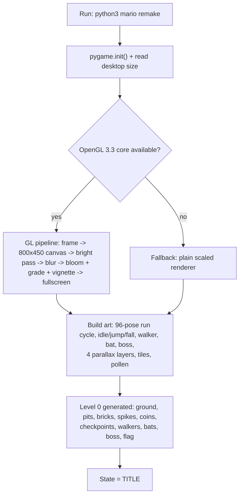
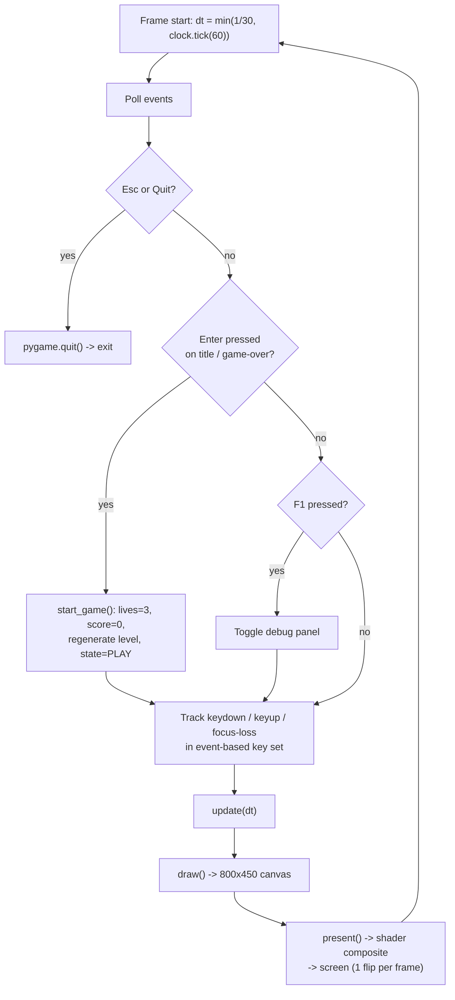
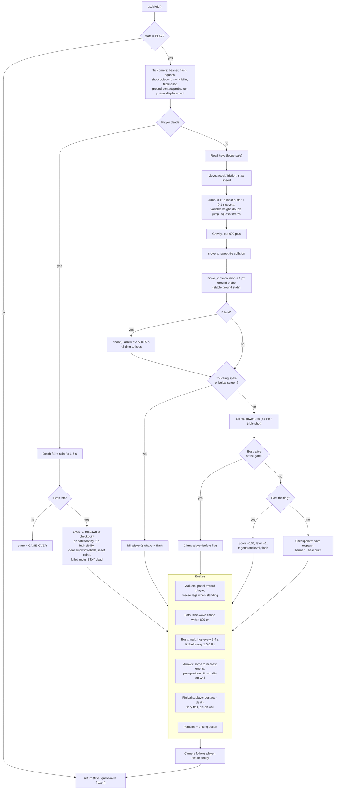
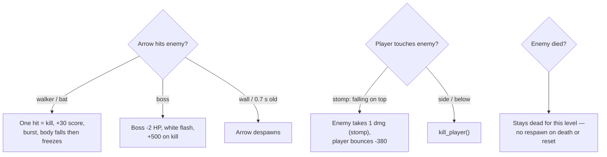
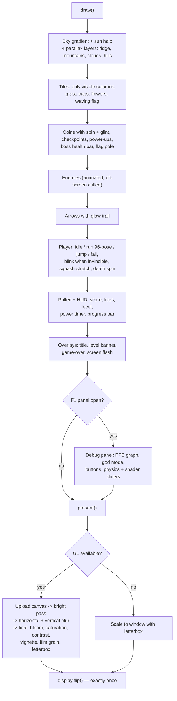

# Homing Bow Bros — Game Flowchart

Every step of the game, from launch to game over. Open this file on GitHub to
see it rendered, or open `flowchart.html` in a browser for a full-screen view.

## Legend

| Shape / Color | Meaning |
| --- | --- |
| ⬛ Rounded | Startup / shutdown |
| 🟦 Blue | Input & event handling |
| 🟩 Green | Gameplay / physics |
| 🟨 Yellow | Rendering |
| 🟥 Red | Damage, death & reset |
| 🟪 Purple | Decisions |

---

## 1. Launch

## 2. Main loop (runs 60 times per second)

## 3. update() — one gameplay tick

## 4. Combat & scoring detail

## 5. draw() + present() — every frame

## 6. State summary

| State | Entered when | Exits when |
| --- | --- | --- |
| `title` | Launch | Enter pressed |
| `play` | Enter on title / restart | Death with 0 lives |
| `over` | Lives run out | Enter → new game |
| *(quit)* | Esc / window close | Process ends |
